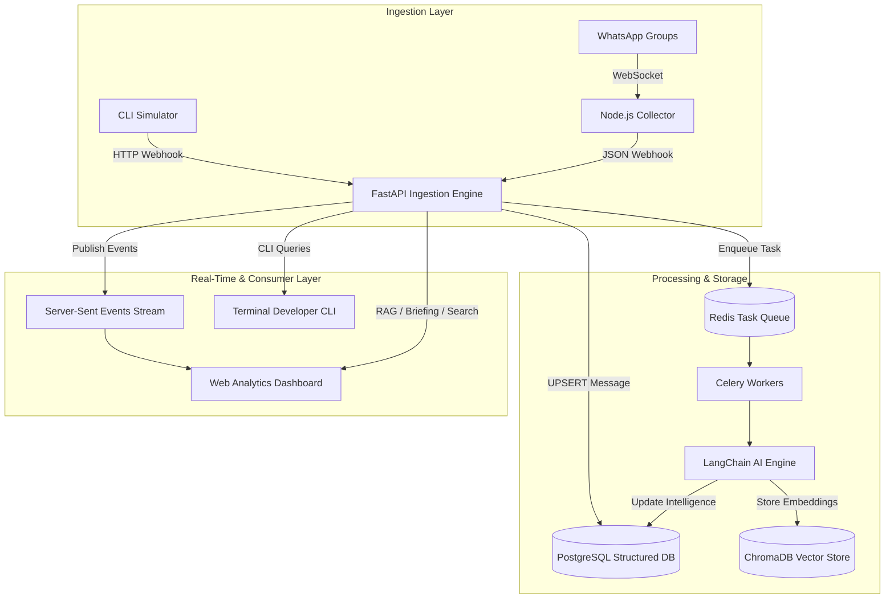
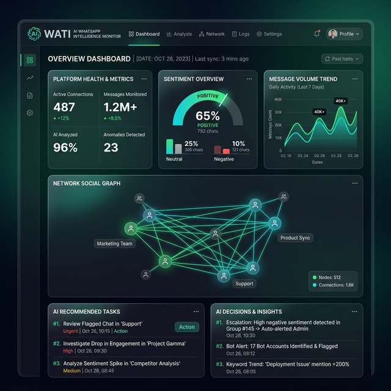

<div align="center">
  

  <br/>

  <h1>💬 AI WhatsApp Intelligence</h1>
  <p><b>Real-Time Group Chat Monitor, Vector RAG & Intelligence Hub</b></p>
  <i>Extract decisions, track sentiment, surface action items, and synthesize executive intelligence briefings autonomously using LangChain, ChromaDB, and LLMs.</i>
  
  <br/>
  
  [](https://python.org)
  [](https://fastapi.tiangolo.com/)
  [](https://langchain.com)
  [](https://www.trychroma.com/)
  [](LICENSE)
</div>

---

## 📑 Table of Contents
- [🌟 Overview](#-overview)
- [🚀 Enterprise Features](#-enterprise-features)
- [🏗️ System Architecture](#️-system-architecture)
- [💻 Developer CLI & Simulator](#-developer-cli--simulator)
- [🛠️ Quick Start Guide](#️-quick-start-guide)
- [📸 Dashboard Preview](#-dashboard-preview)
- [🔒 Privacy & Security](#-privacy--security)
- [🤝 Contributing](#-contributing)
- [📄 License](#-license)

---

## 🌟 Overview

The **AI WhatsApp Intelligence Hub** is an enterprise-grade conversation intelligence platform. It connects to WhatsApp, continuously monitors team and community groups, vectors conversation history into high-dimensional embeddings, and leverages state-of-the-art LLMs to transform high-volume chat streams into structured, actionable intelligence.

Perfect for engineering managers, product teams, operations leads, and community builders who need to extract the "signal from the noise" without reading hundreds of messages every hour.

---

## 🚀 Enterprise Features

* **📡 Headless WhatsApp Collector:** Automated `whatsapp-web.js` collector with HTTP Keep-Alive connection pooling, strict payload truncation, and schema validation.
* **🧠 Conversational Vector RAG (`/ask`):** Ask natural language questions over group history (e.g. *"What did Alex decide about the database migration?"* or *"What bugs were reported today?"*) and receive accurate, vector-grounded answers with direct message citations.
* **🔍 Hybrid Semantic Vector Search (`/search`):** Query group memory with cosine similarity matching against embedded messages, with automatic relational keyword fallback.
* **⚡ Real-Time Intelligence Stream (SSE):** Server-Sent Events feed (`/stream`) delivering instantaneous updates to dashboards and monitoring tools as messages are ingested and analyzed.
* **📊 Autonomous Executive Briefings (`/briefing` & `/export`):** Generates structured briefings across customizable timeframes (24h, 72h, 7d, 30d) with:
  - High-level Executive Summary
  - Formal Decisions Log (with deciders and citations)
  - Prioritized Action Items (with detected urgency levels and assignees)
  - Open Questions & Pending Discussions
  - Multi-Format One-Click Export (`.md`, `.csv`, `.json`)
* **💻 Interactive Developer CLI & Simulator (`python -m app.cli`):** Built-in CLI for subsystem health checks, terminal semantic search, RAG queries, and high-fidelity chat stream simulation.
* **🖥️ Built-In Glassmorphic Dashboard:** Zero-setup web UI served directly at `/dashboard` featuring live SSE streaming, search, Ask-AI chat, and briefing downloads.

---

## 🏗️ System Architecture



---

## 💻 Developer CLI & Simulator

Test, search, and simulate conversations from your terminal without needing a physical phone:

```bash
# 1. Check subsystem health (PostgreSQL, ChromaDB, AI Engine)
python -m app.cli health

# 2. Simulate realistic WhatsApp conversations into the pipeline
python -m app.cli simulate --group dev_core --count 8

# 3. Perform semantic vector search from the terminal
python -m app.cli search "database migration"

# 4. Ask conversational questions over group history (RAG)
python -m app.cli ask "What did the team decide about Redis 7?"

# 5. Generate and print an executive briefing
python -m app.cli briefing --group dev_core --hours 72
```

---

## 🛠️ Quick Start Guide

### 1. Prerequisites
- Docker & Docker Compose
- Node.js 20+
- Python 3.11+

### 2. Infrastructure Setup
Start PostgreSQL, Redis, and ChromaDB:
```bash
docker-compose up -d
```

### 3. Backend Setup
```bash
cd backend
python -m venv venv
source venv/bin/activate  # or venv\Scripts\activate on Windows
pip install poetry
poetry install

# Populate seed intelligence data (optional)
python seed.py

# Launch the FastAPI intelligence server
uvicorn app.main:app --reload --port 8000
```
Visit the interactive dashboard immediately in your browser:
👉 **`http://localhost:8000/dashboard`**

### 4. Collector Setup (WhatsApp Web Bridge)
```bash
cd collector
npm install
npm start
# Scan the terminal QR code with WhatsApp on your phone
```

---

## 📸 Dashboard Preview

<div align="center">
  
</div>

---

## 🔒 Privacy & Security

- **Local-First Data Sovereignty:** All conversation records and vector embeddings reside on your self-hosted infrastructure.
- **Credential Protection:** Automatic connection URI sanitization prevents database credentials from leaking into application logs.
- **Constant-Time Authentication:** API keys validated via `secrets.compare_digest` to mitigate timing attack vectors.

---

## 🤝 Contributing

Contributions are welcome! Please submit issues or pull requests for additional channel connectors (e.g. Slack, Telegram, Discord), specialized analytical classifiers, or UI enhancements.

---

## 📄 License

This project is licensed under the [GNU General Public License v3.0 (GPL-3.0-or-later)](LICENSE).
